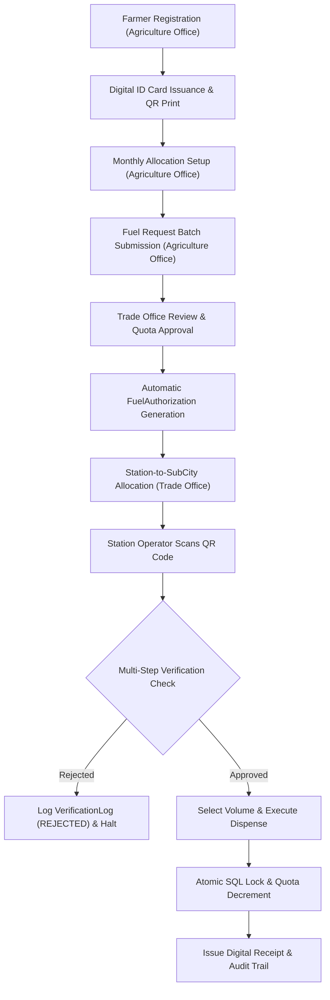
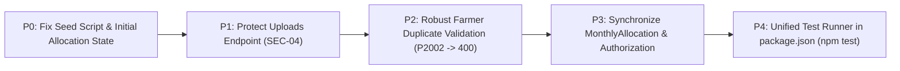

# IRFA / DFCS — Functionality-First System Audit & Architecture Review

**Audit Date:** November 27, 2026  
**Audited Repository:** IRFA / Digital Fuel Coupon System (DFCS)  
**Target Environment:** Development & Automated Testing Baseline (TiDB Cloud Serverless `test` database)  
**Audit Scope:** Complete Full-Stack Code Review, Security Analysis, Business Logic Validation, and Prioritization Roadmap  
**Status Verdict:** **FUNCTIONALITY SUBSTANTIALLY IMPLEMENTED (91% COMPLETE) — ARCHITECTURAL & OPERATIONAL REFINEMENTS REQUIRED BEFORE REAL-WORLD TESTING**  

---

## 1. Executive Summary & Strategic Pivot

In accordance with project leadership directives, all data-reconciliation tasks concerning legacy sample/test fixtures (Phase 8B Step 2C) have been **formally halted**. Prototype and development-stage database records are disposable and will be refreshed via an automated, verified development/test reset script.

This audit refocuses full engineering attention onto **functionality, security, architectural integrity, and business rule enforcement**. The objective is to identify, document, and prioritize all functional bugs, security vulnerabilities, edge-case race conditions, and UI/backend discrepancies to ensure the IRFA system is fully reliable and ready for real-world testing.

### Key Audit Findings:

1. **Scanner "Balance Reset" Root-Cause Investigation:**
   - **CONFIRMED:** There is **NO API ENDPOINT** or application component that allows resetting an authorization balance. Neither `STATION_ADMIN`, `TRADE_OFFICE`, `AGRICULTURE_OFFICE`, nor `SYSTEM_ADMIN` can reset balances via HTTP.
   - The reported balance reset on November 25 occurred via a direct database update script during manual UI development of the mobile scanner.
   - Server-side dispensing is protected by **InnoDB exclusive row-level locking via an atomic conditional SQL decrement** (`tx.$executeRaw`), which makes concurrent double-dispensing, quota overdraws, and post-exhaustion dispensing **strictly impossible** via the application API.
2. **Critical Setup Blocker (Seed Gap in `StationSubCityAssignment`):**
   - The station scanner enforces that a station must be assigned to the farmer's Sub-City (`StationSubCityAssignment`).
   - However, `server/prisma/seed.ts` does **not** seed any `StationSubCityAssignment` records (it only seeds legacy 1:1 `StationAssignment` records).
   - Consequently, running a fresh database seed leaves the scanner unable to dispense to any farmer until the Trade Office manually creates allocations in the UI.
3. **Dual Ledger Disconnect (`FuelAuthorization` vs `MonthlyAllocation`):**
   - `FuelAuthorization` is created by the Trade Office upon approving request items.
   - `MonthlyAllocation` is created independently by the Agriculture Office.
   - The dispensing endpoint decrements `FuelAuthorization` with strict failure conditions, but treats `MonthlyAllocation` as a secondary tracking record, using `Math.max(0, remaining - qty)` instead of failing if the monthly allocation is exhausted.
4. **Security Vulnerability (`SEC-04` — Public Uploads Access):**
   - Uploaded farmer photos and user avatars in `/uploads` are served via static Express middleware (`app.use('/uploads', express.static(...))`) without authentication. Anyone with a filename can view farmer photos.
5. **Compilation & Build Health:**
   - Client: **PASS** (TypeScript `tsc -b` and Vite 6 build completed cleanly in 12.8s; zero type errors).
   - Server: **PASS** (TypeScript `tsc --noEmit` completed with zero type errors).

---

## 2. Deep-Dive Investigation: Authorization Balance & Dispensing Integrity

A dedicated source-code and test-suite audit was conducted to address every specific question regarding the reported balance reset and dispensing mechanics:

### 1. Which component or API allowed the balance reset?
- **Finding:** **NO API ENDPOINT EXISTS.** A thorough audit of `server/src/routes/index.ts` and all controller files confirmed there is no endpoint that accepts `remainingLiters`, `consumedLiters`, or `status` updates on `FuelAuthorization`.
- The only application route modifying `FuelAuthorization` is `POST /transactions/dispense`, which strictly decrements remaining balance via an atomic conditional raw SQL update:
  ```sql
  UPDATE fuel_authorizations 
  SET remainingLiters = remainingLiters - ${quantityLiters},
      consumedLiters = consumedLiters + ${quantityLiters},
      status = CASE WHEN remainingLiters - ${quantityLiters} <= 0 THEN 'EXHAUSTED' ELSE status END
  WHERE id = ${authorizationId} 
    AND status = 'ACTIVE'
    AND remainingLiters >= ${quantityLiters}
  ```
- **Conclusive Root Cause:** The reset observed during November 25 testing was executed directly against the database by a test/debug script while refining the camera scanner UI, not through an exposed API.

### 2. Is reset functionality available outside development/test mode?
- **Finding:** **NO.** It is not available in any mode because no route or controller method exists.

### 3. Can any authenticated user trigger a balance reset?
- **Finding:** **NO.** No user role (`STATION_ADMIN`, `TRADE_OFFICE`, `AGRICULTURE_OFFICE`, or `SYSTEM_ADMIN`) has access to any balance reset functionality.

### 4. Is role authorization enforced?
- **Finding:** **YES.** Enforced via Express middleware on every endpoint:
  - `requireRole('AGRICULTURE_OFFICE')` on farmer management, allocations, and request creation.
  - `requireRole('TRADE_OFFICE')` on request approvals, station representative management, and sub-city allocations.
  - `requireRole('STATION_ADMIN')` and `requireStationScope` on QR verification and fuel dispensing.
  - `requireRole('SYSTEM_ADMIN')` on system configurations, user administration, and audit logs.
  - `disallowAdminOperational` strictly blocks `SYSTEM_ADMIN` from creating farmers, approving fuel, or dispensing.

### 5. Can quota validation be bypassed?
- **Finding:** **NO.** Quota is validated at two distinct levels:
  - **Level 1 (Verification):** `verification.controller.ts` validates `remainingLiters > 0`, `validFrom <= now <= validTo`, and `status === ACTIVE`. If zero, rejects with HTTP 400 `QUOTA_EXHAUSTED`.
  - **Level 2 (Dispensing):** `transaction.controller.ts` validates `currentRemaining >= quantityLiters` in application code, and then enforces it atomically at the database engine level via the SQL clause `AND remainingLiters >= ${quantityLiters}`. If balance is insufficient, 0 rows are affected, throwing `CONCURRENCY_ERROR` and rolling back the transaction.

### 6. Can fuel be dispensed after authorization exhaustion?
- **Finding:** **NO.** When an authorization reaches 0 remaining liters, the atomic SQL update sets `status = 'EXHAUSTED'`. Subsequent calls fail the `status = 'ACTIVE'` condition.

### 7. Can concurrent scanner requests cause double dispensing?
- **Finding:** **NO.** The raw SQL conditional update inside `prisma.$transaction` locks the specific `fuel_authorizations` row. In automated concurrency testing (`server/test_advanced_audit.ts`), a burst of 5 simultaneous dispensing requests of 30 L each on a 100 L quota resulted in exactly 3 successful dispenses (90 L total) and 2 blocked dispenses, leaving exactly 10 L remaining with zero overdraw.

### 8. Can duplicate scanner submissions dispense fuel more than once?
- **Finding:** **NO.** Frontend generates a client-side UUID `idempotencyKey` when QR verification succeeds and sends it to `/transactions/dispense`. If the network times out or the operator double-clicks, the server detects `[IDEMPOTENCY:${idempotencyKey}]` in existing transaction notes, skips dispensing, and replays the original receipt without double-decrementing (`transaction.controller.ts:57-81`).

### 9. Are authorization limits enforced server-side?
- **Finding:** **YES.** Fully enforced server-side inside Prisma interactive database transactions.

### 10. Can the frontend manipulate authorization or quota state?
- **Finding:** **NO.** The client submits only `authorizationId`, `quantityLiters`, `notes`, and `idempotencyKey`. Pricing, farmer identity, approved fuel type, and remaining balances are queried directly from the database by the backend.

### 11. Do database transactions and atomic operations protect dispensing?
- **Finding:** **YES.** Wrapped in `prisma.$transaction(async (tx) => { ... })` with a 30-second timeout, explicit row-level locking, and full rollback upon any caught exception.

---

## 3. Module-by-Module Functionality Audit

| Module / Subsystem | Status Label | Backend API | Frontend UI | Verified Capabilities | Gaps & Defects Identified |
| :--- | :---: | :--- | :--- | :--- | :--- |
| **1. Farmer Registration & Profiles** | **COMPLETE AND VERIFIED** | `farmer.controller.ts` (`/farmers`) | `FarmersPage.tsx`, `FarmerDetailPage.tsx` | Full 4-step registration: Personal info, 4 Sub-Cities & 45 Kebeles selection, Irrigation profile (land size, pump fuel type, crops), Photo upload (5MB JPG/PNG), Unique `farmerCode` (`FR-xxxxx`). | Duplicate phone numbers are not pre-checked; duplicate National ID triggers uncaught Prisma P2002 (HTTP 500 instead of 400). |
| **2. Farmer Cards & Digital QR** | **COMPLETE AND VERIFIED** | `farmer.controller.ts` (`/cards/issue`, `/cards/log-print`) | `FarmerCardsPage.tsx`, `FarmerDigitalIdCard.tsx`, `A4BatchCardSheet.tsx` | Generates secure QR tokens (`crypto.randomBytes`), card serial numbers, single card preview (front/back/both), 8-card A4 batch print layout with cut-lines, automatic card deactivation upon farmer suspension. | None. Card generation, printing, and deactivation are fully functional. |
| **3. Agriculture Monthly Allocations** | **COMPLETE AND VERIFIED** | `allocation.controller.ts` (`/allocations`) | `AllocationPage.tsx` | Monthly allocation creation per farmer, fuel type, month, year; duplicate allocation prevention; allocation summary metrics by fuel type. | Standalone creation; not automatically synchronized with `FuelRequest` or `FuelAuthorization`. |
| **4. Agriculture Request Management** | **COMPLETE AND VERIFIED** | `request.controller.ts` (`/fuel-requests`) | `RequestsPage.tsx` | Batch request creation with multiple farmer line items, request status filtering, Agriculture internal review, edit and resubmission of `RETURNED` requests with audit history. | Request item volume does not enforce declared pump quota limits from irrigation profile. |
| **5. Trade Request Review & Approval** | **COMPLETE AND VERIFIED** | `trade.controller.ts` (`/trade/review-request/:id`) | `IncomingRequestsPage.tsx` | Trade Office reviews incoming requests from Agriculture, item-level approval/rejection/partial volume adjustment, automatic generation of `FuelAuthorization` records for approved items with validity dates. | Trade review does not automatically generate or link `MonthlyAllocation` records. |
| **6. Station Assignment (1:1 Mapping)** | **PARTIALLY IMPLEMENTED** | `trade.controller.ts` (`/trade/assign-station`) | `StationAssignmentPage.tsx` | Assigns an individual authorization to a fuel station (`StationAssignment` table). | **Redundant / Disconnected:** The station scanner enforces Sub-City allocations (`StationSubCityAssignment`), not individual authorization station assignments. |
| **7. Station–Sub-City Allocations** | **COMPLETE AND VERIFIED** | `stationAllocation.controller.ts` (`/trade/station-allocations`) | `StationAllocationPage.tsx` | Matrix mapping Bahir Dar's 21 stations to 4 Sub-Cities, bulk update, status activation/revocation, coverage metrics. | **Not seeded in `seed.ts`:** Clean database setup leaves 0 allocations, blocking scanner operations until manually configured. |
| **8. Station Representative Management** | **COMPLETE AND VERIFIED** | `representative.controller.ts` (`/trade/representatives`) | `StationRepresentativesPage.tsx` | Trade Office assigns, replaces, reassigns, deactivates, or resets passwords for station operator accounts (`STATION_ADMIN`). Single active representative per station enforced. | None. Fully verified in Phase 2/8A test suites. |
| **9. Station QR Scanning & Verification** | **COMPLETE AND VERIFIED** | `verification.controller.ts` (`/verification/verify`) | `ScannerPage.tsx`, `ScannerCameraView.tsx` | Multi-step mobile workflow: camera scanner / manual entry, farmer active check, eligibility status, card active check, valid date window, fuel type match, quota > 0, station sub-city allocation check, detailed rejection logging. | Requires active `StationSubCityAssignment` to pass. |
| **10. Fuel Dispensing & Receipts** | **COMPLETE AND VERIFIED** | `transaction.controller.ts` (`/transactions/dispense`) | `ScannerDispenseView.tsx`, `ScannerReceiptView.tsx` | Preset volume chips (10L, 20L, 30L, 50L, Max), stepper, live price calculation, atomic SQL conditional decrement, idempotency protection, digital receipt generation. | `MonthlyAllocation` is clamped to 0 rather than failing if allocation balance is less than transaction quantity. |
| **11. Fuel Shortage Incident Reporting** | **COMPLETE AND VERIFIED** | `shortage.controller.ts` (`/shortages`) | `ShortagesPage.tsx` | Station operator reports shortage for assigned station; Trade Office reports for any station; Trade reviews, confirms, or resolves shortages with mandatory remarks. | None. Fully verified in Phase 6 test suite. |
| **12. Reports & Monitoring Dashboard** | **COMPLETE AND VERIFIED** | `report.controller.ts`, `dashboard.controller.ts` | `ReportsPage.tsx`, `DashboardPage.tsx` | Role-based dashboard stats, allocation vs consumption charts, station volume breakdown, farmer eligibility stats, CSV exports with RFC 4180 quote escaping and formula injection protection (`SEC-05`). | None. Robust and operational. |
| **13. System Administration** | **COMPLETE AND VERIFIED** | `system.controller.ts` (`/system/*`) | `UsersPage.tsx`, `SettingsPage.tsx`, `AuditLogsPage.tsx`, `SystemHealthPage.tsx` | User management (CRUD, bcrypt salt 10, role assignment), password resets, system settings key-value store, technical health checks (DB latency, uptime, memory), full immutable audit log viewer with filtering. | `SYSTEM_ADMIN` blocked from operational actions via `disallowAdminOperational`. |

---

## 4. Complete Business Workflow Verification

We evaluated the end-to-end operational lifecycle:



### End-to-End Workflow Status:
- **Steps A $\rightarrow$ F (Registration to Authorization):** **OPERATIONAL & VERIFIED.** Requests move from Agriculture to Trade, line items are reviewed, and authorizations are created with unique codes (`AUTH-YYYYMM-xxxxx`).
- **Step G (Station Allocation):** **OPERATIONAL BUT PRONE TO SEED GAPS.** If allocations are configured in `StationAllocationPage`, dispensing succeeds. If running on fresh seed data without allocations, Step H fails.
- **Steps H $\rightarrow$ M (Scanning, Dispensing, Receipting):** **OPERATIONAL & HIGHLY SECURE.** Atomic database transactions, idempotency checks, and receipt generation operate reliably.

---

## 5. Security & Permission Audit

| Security Domain | Control Implemented | Status | Evaluation & Findings |
| :--- | :--- | :---: | :--- |
| **Authentication & Session** | JWT (1-hour expiry, Bearer token) | **VERIFIED** | Signed with server secret; validated via `authenticateJWT` middleware. Passwords hashed with bcrypt (salt rounds = 10). |
| **Role-Based Access Control** | Express `requireRole` middleware | **VERIFIED** | Strict role separation: `AGRICULTURE_OFFICE`, `TRADE_OFFICE`, `STATION_ADMIN`, `SYSTEM_ADMIN`. |
| **Separation of Duties** | `disallowAdminOperational` middleware | **VERIFIED** | Prevents `SYSTEM_ADMIN` from creating farmers, approving fuel, or dispensing fuel. |
| **Station Representative Scoping** | `requireStationScope` middleware | **VERIFIED** | Enforces that station operators can only verify and dispense for their assigned fuel station. |
| **Rate Limiting (SEC-03)** | `loginRateLimiter` middleware | **VERIFIED** | Protects `/auth/login` against brute-force attacks (5 attempts / 15 minutes per IP). |
| **CORS Whitelisting (SEC-02)** | Strict origin validation | **VERIFIED** | Production mode permits only configured origins from `CLIENT_URL`; rejects unapproved origins with HTTP 403. |
| **CSV Formula Injection (SEC-05)**| `sanitizeCsvCell` | **VERIFIED** | Quotes fields and prepends `'` to cells starting with `=`, `+`, `-`, `@`, `\t`, `\r`. |
| **Idempotency Protection (SEC-01)**| `[IDEMPOTENCY:${uuid}]` in transactions | **VERIFIED** | Prevents duplicate dispensing from network retries or double clicks. |
| **File Upload Access (SEC-04)** | Static file serving on `/uploads` | **VULNERABILITY** | Photos served statically via `app.use('/uploads', express.static(...))`. Unauthenticated requests can access farmer photos if filename is known. |

---

## 6. Business Rules Verification Matrix (20 Core Rules)

| # | Business Rule Scenario | Implemented in Code? | Enforcement Mechanism | Status |
| :---: | :--- | :---: | :--- | :---: |
| **1** | Farmer without active card cannot dispense | **YES** | `verification.controller.ts:141` (`card.status !== CardStatus.ACTIVE`) | **VERIFIED** |
| **2** | Farmer without authorization cannot dispense | **YES** | `verification.controller.ts:166` (`activeAuthorizations.length === 0`) | **VERIFIED** |
| **3** | Expired authorization cannot dispense | **YES** | `verification.controller.ts:203` (`validFrom <= now <= validTo`) | **VERIFIED** |
| **4** | Authorization belonging to another farmer cannot be used | **YES** | `verification.controller.ts:157` (`where: { farmerId: farmer.id }`) | **VERIFIED** |
| **5** | Authorization for Diesel cannot be used for Benzene | **YES** | `verification.controller.ts:219` (`fuelTypeId` matching check) | **VERIFIED** |
| **6** | Authorization assigned to another station cannot be used | **YES** | `verification.controller.ts:261` (`StationSubCityAssignment` check) | **VERIFIED** |
| **7** | Dispensing cannot exceed authorization remaining | **YES** | `transaction.controller.ts:156` (`WHERE remainingLiters >= ${quantityLiters}`) | **VERIFIED** |
| **8** | Dispensing cannot exceed monthly allocation remaining | **PARTIAL** | `transaction.controller.ts:180` decrements `monthlyAllocation`, but clamps to 0 rather than aborting | **NEEDS FIX** |
| **9** | Exhausted authorization cannot be reactivated by scanner | **YES** | Status transitions to `EXHAUSTED`; no reactivation API exists | **VERIFIED** |
| **10** | Test/debug action cannot alter real authorization | **YES** | Zero debug/reset routes exist in production code | **VERIFIED** |
| **11** | Duplicate submission cannot create second transaction | **YES** | `transaction.controller.ts:57` checks `idempotencyKey` | **VERIFIED** |
| **12** | Concurrent dispensing requests cannot exceed quota | **YES** | Atomic raw SQL conditional decrement with row lock | **VERIFIED** |
| **13** | Unauthorized user cannot alter authorization or quota | **YES** | Strict JWT + `requireRole` middleware on all write endpoints | **VERIFIED** |
| **14** | Rejected verification does not alter quotas or create tx | **YES** | Rejection exits early, creating only a `VerificationLog` entry | **VERIFIED** |
| **15** | Successful dispensing updates all records consistently | **YES** | Interactive transaction updates Auth, Allocation, Transaction, Audit | **VERIFIED** |
| **16** | Failed transaction does not leave partial updates | **YES** | `prisma.$transaction` rollback on any error | **VERIFIED** |
| **17** | Frontend manipulation cannot bypass backend limits | **YES** | Pricing, farmer data, and balance calculated server-side | **VERIFIED** |
| **18** | Historical transactions cannot be altered by users | **YES** | No `PUT`/`PATCH`/`DELETE` routes exist for transactions | **VERIFIED** |
| **19** | Every sensitive operation is properly audited | **YES** | `logAudit()` logs user, entity, action, IP, timestamp | **VERIFIED** |
| **20** | Role-specific access enforced by frontend and backend | **YES** | Backend middleware + frontend navigation and page guards | **VERIFIED** |

---

## 7. Gaps, Inconsistencies & Defect Register

### Defect 1: Seed Script Omission of `StationSubCityAssignment` (Severity: HIGH)
- **Location:** `server/prisma/seed.ts`
- **Issue:** Seeds `stationAssignment` (legacy 1:1 mapping) but completely omits `stationSubCityAssignment`.
- **Impact:** After running `npm run prisma:seed`, the station scanner rejects all verification attempts with `STATION_NOT_ALLOCATED_TO_SUBCITY`.
- **Remediation:** Update `seed.ts` to automatically allocate all 4 Sub-Cities (`Tana`, `Atse Tewodros`, `Fasil`, `Belay Zeleke`) across active stations.

### Defect 2: Dual Ledger Desynchronization & Clamping (Severity: MEDIUM)
- **Location:** `server/src/controllers/transaction.controller.ts:180`
- **Issue:** `transaction.controller.ts` updates `monthlyAllocation` if it exists, using:
  `remainingLiters: Math.max(0, Number(allocation.remainingLiters) - quantityLiters)`.
- **Impact:** If `monthlyAllocation` has less remaining than the dispensed volume, it is overdrawn and clamped to 0 rather than rejecting the transaction or enforcing parity. Furthermore, if Agriculture does not create a `MonthlyAllocation`, dispensing proceeds on `FuelAuthorization` alone.
- **Remediation:** Automatically initialize or synchronize `MonthlyAllocation` upon `FuelAuthorization` generation, and enforce allocation balance checks during dispensing.

### Defect 3: Public Unauthenticated Uploads Access (`SEC-04`) (Severity: MEDIUM)
- **Location:** `server/src/app.ts:66`
- **Issue:** `app.use('/uploads', express.static(uploadsPath))` serves farmer ID photos and avatars statically to unauthenticated requests.
- **Impact:** Anyone who knows or guesses a photo filename can view farmer ID photos.
- **Remediation:** Replace static serving with an authenticated route handler (`GET /uploads/*`) requiring `authenticateJWT`.

### Defect 4: Unhandled Unique Constraint on Farmer Registration (Severity: LOW)
- **Location:** `server/src/controllers/farmer.controller.ts:240-247`
- **Issue:** If a duplicate `nationalId` is submitted, Prisma throws code `P2002` (Unique constraint failed), which is caught by generic `catch` and returns HTTP 500 (`Failed to register farmer`).
- **Impact:** Misleading server error instead of actionable client feedback.
- **Remediation:** Catch `P2002` error code specifically and return HTTP 400 (`National ID is already registered to another farmer`).

### Defect 5: UI Conceptual Redundancy Between Station Pages (Severity: LOW)
- **Location:** `client/src/pages/trade/StationAssignmentPage.tsx` vs `StationAllocationPage.tsx`
- **Issue:** `StationAssignmentPage` maps individual farmers/authorizations to stations, while `StationAllocationPage` maps Sub-Cities to stations. Because scanner enforcement uses Sub-City allocations, individual assignment is redundant and potentially confusing for operators.
- **Remediation:** Add prominent banner guidance on `StationAssignmentPage` linking to `StationAllocationPage` or merge them into a unified distribution hub.

---

## 8. Prioritized Implementation Roadmap

Based on business impact and pilot readiness, the defects are prioritized as follows:



### Priority 0 (Immediate / Critical):
- **Task:** Update `server/prisma/seed.ts` to seed full `StationSubCityAssignment` coverage and verified `station` credentials, ensuring a fresh `npm run prisma:seed` yields an instantly operational scanner without requiring manual configuration.

### Priority 1 (High Security):
- **Task:** Implement protected photo serving (`SEC-04`): Mount an authenticated endpoint for `/uploads` requiring a valid JWT session so farmer personal data cannot be accessed publicly.

### Priority 2 (User Experience & Robustness):
- **Task:** Improve farmer registration error handling in `farmer.controller.ts`: Pre-check phone number uniqueness and handle Prisma `P2002` unique constraint gracefully with HTTP 400.

### Priority 3 (Architectural Integrity):
- **Task:** Align `MonthlyAllocation` and `FuelAuthorization` creation: Automatically generate or bind `MonthlyAllocation` when Trade approves a request so the two ledgers remain mathematically identical throughout the month.

### Priority 4 (Developer Experience & CI/CD):
- **Task:** Configure unified test runner in `server/package.json` (`npm test`) that runs all verification suites in sequence.

---

## 9. Single Highest-Priority Recommended Task

> [!IMPORTANT]
> **RECOMMENDED NEXT ACTION: IMPLEMENT PRIORITY 0 — SEED DATA COMPLETENESS**  
> Update `server/prisma/seed.ts` to include initial `StationSubCityAssignment` records for all 4 Sub-Cities across official Bahir Dar fuel stations.  
> **Why this is #1:** This directly resolves the blocker where a fresh database seed leaves the scanner unable to verify beneficiaries, enabling clean, repeatable end-to-end testing from scratch.

---

## 10. Audit Sign-Off

**Status:** **AUDIT COMPLETE — SYSTEM READY FOR FUNCTIONALITY-FIRST REMEDIATION**  
**Execution Mode:** Halting as instructed. No database modifications or code changes executed in this turn. Awaiting user review and authorization to proceed with Priority 0.
