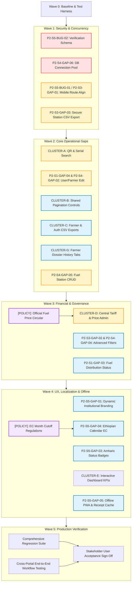
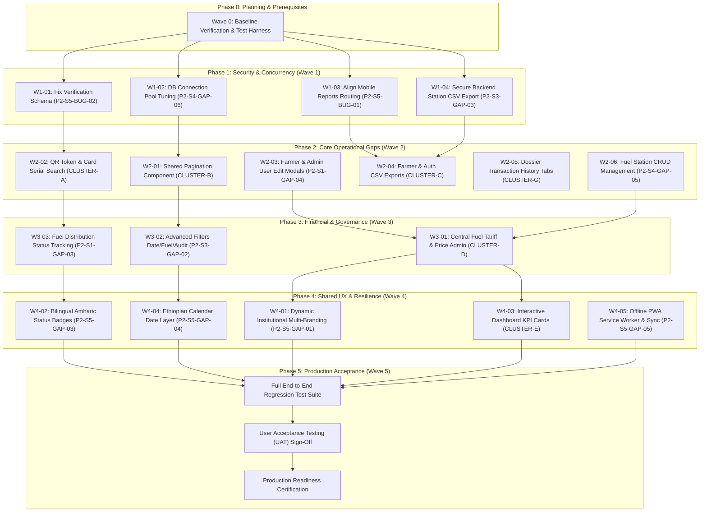

# IRFA / Digital Fuel Coupon System
# PRIORITY 3 — STAGE 0: MASTER REMEDIATION ROADMAP & DEPENDENCY ANALYSIS

**Project:** Digital Fuel Coupon System (IRFA) — Bahir Dar City Administration  
**Document:** `PRIORITY_3_MASTER_REMEDIATION_ROADMAP.md`  
**Author:** Antigravity AI Senior QA & Systems Engineering Team  
**Evaluation Mode:** STRICT PLANNING-ONLY (Zero Code Fixes, Zero Schema Changes, Zero Migrations)  
**Date:** November 28, 2026  
**Artifact Directory:** `C:\Users\1234\.gemini\antigravity\brain\cd1b2618-018f-4d4d-a1a5-e15c803d4780\`  
**Target Environment:** Local Node Express Backend (Port 5000) + Vite React Frontend (Port 3000) + TiDB Cloud Serverless DB

---

## 1. EXECUTIVE SUMMARY

The Digital Fuel Coupon System (IRFA) has completed its five-stage Functional Completeness Audit under Priority 2. Every portal was thoroughly audited and classified as **`COMPLETE WITH GAPS`**. Across all audits, the core architectural foundations—cryptographic token validation, dual-ledger quota decrementing, atomic database transactions, pessimistic row locks, and role-based access control (RBAC) boundaries—were proven robust, tamper-resistant, and operationally sound.

This document establishes the master, evidence-based remediation roadmap for **Priority 3: Functional Remediation & Production Hardening**. It consolidates every documented gap, defect, and stakeholder requirement from the five audit reports into a single, unified register. Each item has been analyzed for root cause, implementation complexity, cross-portal impact, security implications, and policy dependencies.

Remediation is structured into **six sequential implementation waves (Waves 0 through 5)**. This phased structure guarantees that critical security and concurrency vulnerabilities are addressed first, core operational capabilities second, financial accuracy third, shared localization fourth, and complete end-to-end regression verification last.

---

## 2. PRIORITY 2 COMPLETION ACKNOWLEDGMENT

The Priority 2 Functional Completeness Audit comprised five rigorous, read-only stages. All five stages have been completed, formally reviewed, and accepted:

1. **Stage 1 — Agriculture Office Portal:** Classified as `COMPLETE WITH GAPS` (Audit report: [PRIORITY_2_STAGE_1_AGRICULTURE_PORTAL_FUNCTIONAL_AUDIT.md](file:///c:/Users/1234/Desktop/IRFA/PRIORITY_2_STAGE_1_AGRICULTURE_PORTAL_FUNCTIONAL_AUDIT.md)).
2. **Stage 2 — Trade Office Portal:** Classified as `COMPLETE WITH GAPS` (Audit report: [PRIORITY_2_STAGE_2_TRADE_PORTAL_FUNCTIONAL_AUDIT.md](file:///c:/Users/1234/Desktop/IRFA/PRIORITY_2_STAGE_2_TRADE_PORTAL_FUNCTIONAL_AUDIT.md)).
3. **Stage 3 — Fuel Station Portal:** Classified as `COMPLETE WITH GAPS` (Audit report: [PRIORITY_2_STAGE_3_FUEL_STATION_PORTAL_FUNCTIONAL_AUDIT.md](file:///c:/Users/1234/Desktop/IRFA/PRIORITY_2_STAGE_3_FUEL_STATION_PORTAL_FUNCTIONAL_AUDIT.md)).
4. **Stage 4 — System Administration Portal:** Classified as `COMPLETE WITH GAPS` (Audit report: [PRIORITY_2_STAGE_4_SYSTEM_ADMIN_PORTAL_FUNCTIONAL_AUDIT.md](file:///c:/Users/1234/Desktop/IRFA/PRIORITY_2_STAGE_4_SYSTEM_ADMIN_PORTAL_FUNCTIONAL_AUDIT.md)).
5. **Stage 5 — Shared Functionality & Cross-Portal Audit:** Classified as `COMPLETE WITH GAPS` (Audit report: [PRIORITY_2_STAGE_5_SHARED_FUNCTIONALITY_CROSS_PORTAL_AUDIT.md](file:///c:/Users/1234/Desktop/IRFA/PRIORITY_2_STAGE_5_SHARED_FUNCTIONALITY_CROSS_PORTAL_AUDIT.md)).

Zero temporary workarounds were deployed, and zero production records were modified during Priority 2.

---

## 3. SOURCE AUDIT REPORTS REVIEWED

The roadmap synthesizes findings directly from the complete text of the five source audit reports and their associated visual and programmatic test artifacts:

| Audit Stage | Document Name | File Path | Scope | Automated Assertions |
| :--- | :--- | :--- | :--- | :---: |
| **Stage 1** | Agriculture Portal Audit | [Stage 1 Report](file:///c:/Users/1234/Desktop/IRFA/PRIORITY_2_STAGE_1_AGRICULTURE_PORTAL_FUNCTIONAL_AUDIT.md) | Farmer registration, quotas, requests, dossiers | 32 Assertions |
| **Stage 2** | Trade Office Audit | [Stage 2 Report](file:///c:/Users/1234/Desktop/IRFA/PRIORITY_2_STAGE_2_TRADE_PORTAL_FUNCTIONAL_AUDIT.md) | Reviewing batches, authorizations, stations | 34 Assertions |
| **Stage 3** | Fuel Station Audit | [Stage 3 Report](file:///c:/Users/1234/Desktop/IRFA/PRIORITY_2_STAGE_3_FUEL_STATION_PORTAL_FUNCTIONAL_AUDIT.md) | QR scan, photo auth, dispensing, receipts | 36 Assertions |
| **Stage 4** | System Admin Audit | [Stage 4 Report](file:///c:/Users/1234/Desktop/IRFA/PRIORITY_2_STAGE_4_SYSTEM_ADMIN_PORTAL_FUNCTIONAL_AUDIT.md) | Users, roles, settings, audit logs, health | 39 Assertions |
| **Stage 5** | Shared / Cross-Portal | [Stage 5 Report](file:///c:/Users/1234/Desktop/IRFA/PRIORITY_2_STAGE_5_SHARED_FUNCTIONALITY_CROSS_PORTAL_AUDIT.md) | RBAC, branding, tariff, calendar, mobile UX | 38 Assertions |

---

## 4. MASTER FINDINGS REGISTER

Below is the consolidated register of all 34 individual findings documented across Stages 1 through 5. Every original identifier has been preserved. All items are in **`OPEN`** status.

| Original ID | Stage | Finding Title | Original Severity | Proposed Priority | Category | Complexity | Risk | Proposed Stage | Status |
| :--- | :---: | :--- | :---: | :---: | :--- | :---: | :---: | :---: | :---: |
| **`P2-S1-GAP-01`** | Stage 1 | Missing Farmer Registry CSV/Excel Export | HIGH | **P2** | Export & Reporting | Medium | Low | Wave 2 | **OPEN** |
| **`P2-S1-GAP-02`** | Stage 1 | Search Omission of Card QR Token & Card Serial | HIGH | **P1** | Search & Discovery | Small | Low | Wave 2 | **OPEN** |
| **`P2-S1-GAP-03`** | Stage 1 | Absence of Fuel Distribution Status Filtering | MEDIUM | **P2** | Data Usability | Medium | Low | Wave 3 | **OPEN** |
| **`P2-S1-GAP-04`** | Stage 1 | Missing Farmer Information Editing Interface | HIGH | **P1** | Core CRUD | Medium | Medium | Wave 2 | **OPEN** |
| **`P2-S1-GAP-05`** | Stage 1 | Dossier Omits Transaction History & Authorizations | MEDIUM | **P2** | UI Completeness | Small | Low | Wave 2 | **OPEN** |
| **`P2-S1-GAP-06`** | Stage 1 | Lack of Fuel Price Management & ETB Valuation | MEDIUM | **P1** | Financial Accuracy | Large | Medium | Wave 3 | **OPEN** |
| **`P2-S1-GAP-07`** | Stage 1 | Missing Table Pagination Controls on Registry | MEDIUM | **P2** | UI Usability | Small | Low | Wave 2 | **OPEN** |
| **`P2-S1-BUG-01`** | Stage 1 | Card Serial Search Placeholder Mismatch | LOW | **P3** | UI Text Polish | Small | Low | Wave 2 | **OPEN** |
| **`P2-S1-BUG-02`** | Stage 1 | Implicit 50-Record Ceiling in Farmer Table | MEDIUM | **P2** | UI Usability | Small | Low | Wave 2 | **OPEN** |
| **`P2-S1-BUG-03`** | Stage 1 | Dead Data Binding in Farmer Detail View | LOW | **P3** | Frontend Optimization | Small | Low | Wave 2 | **OPEN** |
| **`P2-S2-GAP-01`** | Stage 2 | Missing Authorizations Table CSV Export | HIGH | **P2** | Export & Reporting | Medium | Low | Wave 2 | **OPEN** |
| **`P2-S2-GAP-02`** | Stage 2 | Search in Authorizations Omits Card Serial / QR | HIGH | **P1** | Search & Discovery | Small | Low | Wave 2 | **OPEN** |
| **`P2-S2-GAP-03`** | Stage 2 | Lack of ETB Financial Valuation in Requests/Auths | MEDIUM | **P1** | Financial Accuracy | Medium | Low | Wave 3 | **OPEN** |
| **`P2-S2-GAP-04`** | Stage 2 | Authorizations Table Missing Pagination Controls | MEDIUM | **P2** | UI Usability | Small | Low | Wave 2 | **OPEN** |
| **`P2-S2-BUG-01`** | Stage 2 | Non-Interactive Dashboard KPI Cards on Trade | LOW | **P3** | Navigation Drilldown | Small | Low | Wave 4 | **OPEN** |
| **`P2-S3-GAP-01`** | Stage 3 | Missing Dedicated Reports Route for Station Admin | HIGH | **P1** | Navigation & RBAC | Small | Low | Wave 1 | **OPEN** |
| **`P2-S3-GAP-02`** | Stage 3 | Lack of Date-Range & Fuel-Type Filters on Trans. | MEDIUM | **P2** | Data Usability | Medium | Low | Wave 3 | **OPEN** |
| **`P2-S3-GAP-03`** | Stage 3 | Client vs Backend CSV Export Divergence | MEDIUM | **P1** | Export & Security | Small | Low | Wave 1 | **OPEN** |
| **`P2-S3-GAP-04`** | Stage 3 | Station Transactions Table Lacks Pagination | LOW | **P2** | UI Usability | Small | Low | Wave 2 | **OPEN** |
| **`P2-S3-BUG-01`** | Stage 3 | Non-Interactive Station Dashboard KPI Cards | LOW | **P3** | Navigation Drilldown | Small | Low | Wave 4 | **OPEN** |
| **`P2-S4-GAP-01`** | Stage 4 | Lack of Search, Filters & Pagination on Users | HIGH | **P2** | Admin Usability | Medium | Low | Wave 2 | **OPEN** |
| **`P2-S4-GAP-02`** | Stage 4 | Missing Dedicated User Editing Modal in UI | HIGH | **P1** | User Administration | Medium | Medium | Wave 2 | **OPEN** |
| **`P2-S4-GAP-03`** | Stage 4 | Hardcoded Infrastructure Strings in Health UI | MEDIUM | **P3** | Telemetry Accuracy | Small | Low | Wave 4 | **OPEN** |
| **`P2-S4-GAP-04`** | Stage 4 | Audit Logs Page Lacks Date-Range & Entity Filter | MEDIUM | **P2** | Compliance & Audit | Medium | Low | Wave 3 | **OPEN** |
| **`P2-S4-GAP-05`** | Stage 4 | Lack of Runtime Fuel Station CRUD Management | MEDIUM | **P1** | Facility Management | Large | Medium | Wave 2 | **OPEN** |
| **`P2-S4-GAP-06`** | Stage 4 | Connection Pool Bottleneck in Admin Dashboard | MEDIUM | **P0** | Stability & Concurrency| Medium | High | Wave 1 | **OPEN** |
| **`P2-S4-BUG-01`** | Stage 4 | Non-Interactive Admin Dashboard KPI Cards | LOW | **P3** | Navigation Drilldown | Small | Low | Wave 4 | **OPEN** |
| **`P2-S5-BUG-01`** | Stage 5 | Mobile Drawer Route Mismatch for Station/Admin | MEDIUM | **P1** | Routing Integrity | Small | Low | Wave 1 | **OPEN** |
| **`P2-S5-BUG-02`** | Stage 5 | Verification Request Body Schema Vulnerability | HIGH | **P0** | API Security & Robustness | Small | Low | Wave 1 | **OPEN** |
| **`P2-S5-GAP-01`** | Stage 5 | Hardcoded "Office of Agriculture" Subtitle | MEDIUM | **P2** | Institutional Identity| Small | Low | Wave 4 | **OPEN** |
| **`P2-S5-GAP-02`** | Stage 5 | Central Fuel Tariff Invisibility & Price Admin Gap | HIGH | **P1** | Financial Governance | Large | Medium | Wave 3 | **OPEN** |
| **`P2-S5-GAP-03`** | Stage 5 | Status Badges Exclusively in English | MEDIUM | **P2** | Localization (i18n) | Medium | Low | Wave 4 | **OPEN** |
| **`P2-S5-GAP-04`** | Stage 5 | Absence of Ethiopian Calendar (ዓ.ም / EC) | HIGH | **P2** | Localization & Policy | Large | High | Wave 4 | **OPEN** |
| **`P2-S5-GAP-05`** | Stage 5 | Lack of Offline PWA Service Worker & Sync Cache | HIGH | **P2** | Offline Resilience | Large | High | Wave 4 | **OPEN** |

---

## 5. ORIGINAL SEVERITY VERSUS REASSESSED PRIORITY

The audit process re-evaluated all findings based on operational risk, financial accuracy, system stability, and cross-portal dependencies. While original audit severities reflected localized module perspectives, the Priority 3 reassessment ranks issues according to production deployment risk.

### 5.1 Reassessed Priority Distribution

```
  ┌────────────────────────────────────────────────────────────┐
  │  P0 — Critical (Immediate threat to stability/security):  2│
  │  P1 — High (Core integrity, financial oversight, auth):  10│
  │  P2 — Medium (Operational workflows, search, reports):   17│
  │  P3 — Low (Minor UI polish, labels, static text):         5│
  └────────────────────────────────────────────────────────────┘
```

### 5.2 Justification for Key Priority Reassessments

1. **`P2-S5-BUG-02` (Original: HIGH -> Reassessed: P0):**
   - *Rationale:* Destructuring `req.body.qrTokenOrCode` without schema validation causes unhandled Prisma exceptions, crashing verification requests with an unexpected HTTP 500 error. In the field, an unhandled exception at the fuel station terminal stops fuel dispensing and leaks server runtime details. Must be resolved immediately in Wave 1.
2. **`P2-S4-GAP-06` (Original: MEDIUM -> Reassessed: P0):**
   - *Rationale:* Executing 8 parallel database queries inside `Promise.all` in `dashboard.controller.ts` exhausts the serverless connection pool (Prisma error `P2024`). Under peak traffic, this causes cascading 500 errors across other endpoints. Must be prioritized as a foundational infrastructure fix in Wave 1.
3. **`P2-S5-BUG-01` & `P2-S3-GAP-01` (Original: MEDIUM / HIGH -> Reassessed: P1):**
   - *Rationale:* The mobile drawer directs station and system admin users to `/reports`, which is blocked by `RoleRoute` in `AppRoutes.tsx`, bouncing users back to `/dashboard`. Station managers are physically unable to view their daily verification summaries.
4. **`P2-S3-GAP-03` (Original: MEDIUM -> Reassessed: P1):**
   - *Rationale:* The station transaction table uses a client-side CSV download routine that dumps raw memory data without SEC-05 formula injection sanitization or audit trail logging. This represents an export integrity and security vulnerability.
5. **`P2-S5-GAP-04` (Original: HIGH -> Reassessed: P2):**
   - *Rationale:* While adopting the Ethiopian Calendar (ዓ.ም) is critical for local administrative operations in Bahir Dar, the current Gregorian implementation is functionally stable and does not cause data corruption. Transitioning calendar engines requires formal institutional cutoff rules from regional authorities; elevating it to P0/P1 would prematurely block technical remediation.

---

## 6. FINDINGS RECONCILIATION AND DUPLICATES

Multiple audit findings across the five stages stem from shared components, identical backend patterns, or overlapping user requirements. Retaining original IDs, the table below maps how overlapping findings will be tracked and remediated together:

### 6.1 Findings Clusters & Shared Remediation Units

| Cluster Ref | Component / Area | Primary Finding ID | Overlapping / Linked Findings | Reconciliation Strategy |
| :--- | :--- | :--- | :--- | :--- |
| **CLUSTER-A** | QR & Serial Search | `P2-S1-GAP-02` | `P2-S2-GAP-02`, `P2-S1-BUG-01` | Update Prisma `where.OR` queries in `farmer.controller.ts` and `trade.controller.ts` simultaneously to search `Card.qrToken` and `Card.cardSerialNumber`. Update placeholder text on `FarmerCardsPage.tsx`. |
| **CLUSTER-B** | Table Pagination | `P2-S1-GAP-07` | `P2-S1-BUG-02`, `P2-S2-GAP-04`, `P2-S3-GAP-04`, `P2-S4-GAP-01` | Create a reusable `PaginationControls.tsx` component consuming standard pagination metadata (`page`, `limit`, `total`, `totalPages`) and integrate it into Farmers, Authorizations, Transactions, and Users tables. |
| **CLUSTER-C** | CSV Ledger Exports | `P2-S1-GAP-01` | `P2-S2-GAP-01`, `P2-S3-GAP-03` | Implement uniform streaming CSV export endpoints (`GET /farmers/export`, `GET /trade/authorizations/export`, and wire `GET /reports/export?type=station`) enforcing SEC-05 CSV formula sanitization and audit logging. |
| **CLUSTER-D** | Fuel Pricing & Tariffs | `P2-S5-GAP-02` | `P2-S1-GAP-06`, `P2-S2-GAP-03` | Build centralized `FuelPrice` management endpoints under Trade/SysAdmin authority, calculate estimated ETB cost in requests/authorizations (`liters × currentPricePerLiter`), and display ETB financial totals across all portals. |
| **CLUSTER-E** | KPI Card Interactivity | `P2-S2-BUG-01` | `P2-S3-BUG-01`, `P2-S4-BUG-01` | Add `onClick` navigation handlers and `cursor-pointer` styling to `StatCard.tsx` components on Trade, Station, and Admin dashboards to support direct drilldowns into filtered lists. |
| **CLUSTER-F** | Station Reports Access | `P2-S3-GAP-01` | `P2-S5-BUG-01` | Align `MobileMenuDrawer.tsx` and `AppRoutes.tsx` by granting `STATION_ADMIN` and `SYSTEM_ADMIN` access to dedicated reporting views, preventing unexpected redirects to `/dashboard`. |
| **CLUSTER-G** | Farmer Dossier Tabs | `P2-S1-GAP-05` | `P2-S1-BUG-03` | Render existing `transactions` and `authorizations` arrays returned by `GET /farmers/:id` in `FarmerDetailPage.tsx` using tabbed navigation panels, eliminating dead data binding. |

### 6.2 Findings Requiring Database Schema Modifications
- **`P2-S5-GAP-02` (Central Fuel Tariff Management):** Requires adding a `FuelPriceHistory` model or audit fields to `FuelType` in `schema.prisma` (`updatedAt`, `updatedByUserId`, `effectiveDate`) to track historical price adjustments.
- **`P2-S4-GAP-05` (Runtime Fuel Station CRUD):** Requires adding fields to `FuelStation` in `schema.prisma` (`isActive`, `latitude`, `longitude`, `contactPhone`) for operational lifecycle management.
- **`P2-S1-GAP-03` (Fuel Distribution Status Tracking):** Requires adding an indexed computed or stored flag representing monthly quota collection state (`PENDING_COLLECTION`, `PARTIALLY_DISPENSED`, `FULLY_DISPENSED`).

*Note: All schema changes are deferred until Wave 2 and Wave 3, and will require formal schema migration scripts.*

---

## 7. DEPENDENCIES & IMPLEMENTATION CONSTRAINTS

Remediation must respect critical operational and technical dependencies:



---

## 8. PROPOSED IMPLEMENTATION WAVES

### 8.1 Wave 0 — Planning & Prerequisites
* **Scope:** Reconcile all findings; establish immutable git feature branches; verify backend/frontend build harnesses; set up snapshot database test harness.
* **Deliverable:** Baseline regression test suite pass report.

### 8.2 Wave 1 — Security & Concurrency Hardening
* **Scope:** Fix request schema validation vulnerability (`P2-S5-BUG-02`); optimize database connection pool and batch dashboard queries (`P2-S4-GAP-06`); align mobile drawer routing and route guards (`P2-S5-BUG-01`, `P2-S3-GAP-01`); unify station transaction CSV export to secure backend API (`P2-S3-GAP-03`).
* **Deliverable:** Automated verification suite showing 100% pass on security, concurrency, and navigation boundaries.

### 8.3 Wave 2 — Core Operational Functionality
* **Scope:** Implement QR code and card serial search in farmer and authorization registries (`CLUSTER-A`); deploy shared table pagination component (`CLUSTER-B`); implement Farmer Registry and Authorizations CSV export endpoints (`CLUSTER-C`); build inline Farmer Edit Modal and Admin User Edit Modal (`P2-S1-GAP-04`, `P2-S4-GAP-02`); bind dossier transaction history (`CLUSTER-G`); introduce runtime fuel station CRUD (`P2-S4-GAP-05`).
* **Deliverable:** Operational UI test suite verifying search, editing, pagination, and export capabilities.

### 8.4 Wave 3 — Financial & Administrative Accuracy
* **Scope:** Implement central fuel tariff management and price-per-liter administrative API (`CLUSTER-D`); integrate live ETB cost projections across requests, approvals, and station dispensing; add transaction date-range and fuel-type filters (`P2-S3-GAP-02`); add audit log date-range and entity filters (`P2-S4-GAP-04`); introduce fuel distribution status tracking (`P2-S1-GAP-03`).
* **Deliverable:** Financial calculation test suite proving decimal ETB parity across all portals.

### 8.5 Wave 4 — Shared UX, Localization & Resilience
* **Scope:** Dynamic institutional branding in navigation sidebar and page titles (`P2-S5-GAP-01`); bilingual Amharic status badges and pills (`P2-S5-GAP-03`); interactive dashboard KPI stat cards (`CLUSTER-E`); system health dynamic telemetry (`P2-S4-GAP-03`); Ethiopian Calendar (ዓ.ም) presentation layer (`P2-S5-GAP-04`); Progressive Web App (PWA) offline Service Worker and local token verification cache (`P2-S5-GAP-05`).
* **Deliverable:** Mobile and desktop UI audit report verifying localization, ergonomics, and offline tolerance.

### 8.6 Wave 5 — Regression, Acceptance & Production Readiness
* **Scope:** Execute full automated end-to-end business workflow regression suite; perform cross-portal verification across all 4 operational roles; run stress and concurrency tests on fuel dispensing; conduct stakeholder user acceptance testing (UAT); issue production readiness certification.
* **Deliverable:** Formal `PRIORITY_3_FINAL_VERIFICATION_REPORT.md` and sign-off certificate.

---

## 9. DETAILED WAVE 1 PLAN (SECURITY & CONCURRENCY)

Wave 1 must be executed first to eliminate server-crash vulnerabilities and navigation defects before functional capabilities are expanded.

### 9.1 Task W1-01: Verification Request Body Schema Validation (`P2-S5-BUG-02`)
* **Files Affected:** `server/src/controllers/verification.controller.ts`, `server/src/validators/dispense.validator.ts`, `server/src/routes/index.ts`.
* **Action:**
  1. Define `verifyQrSchema` in `dispense.validator.ts` enforcing `qrTokenOrCode` presence, string type, non-empty trimmed value, and maximum length constraint (2048 chars).
  2. Apply `validate(verifyQrSchema)` middleware on `POST /verification/verify`.
  3. Ensure `verification.controller.ts` returns a clean HTTP 400 Bad Request with `{ success: false, message: "Invalid or missing QR token" }` on malformed input, eliminating unhandled Prisma 500 errors.
* **Verification Assertion:** Submit empty payload `{}` and malformed payload `{ token: 123 }`; verify HTTP 400 Bad Request is returned without triggering server stack traces.

### 9.2 Task W1-02: Connection Pool Tuning & Query Batching (`P2-S4-GAP-06`)
* **Files Affected:** `server/src/config/db.ts`, `server/src/controllers/dashboard.controller.ts`.
* **Action:**
  1. In `db.ts`, append connection pool parameters to `DATABASE_URL` (`connection_limit=15&pool_timeout=20`).
  2. In `dashboard.controller.ts` line 405 (`getAdminDashboard`), refactor the 8 parallel `prisma.*.count()` queries from an unmanaged `Promise.all` into sequential batches of 3, or combine them into an aggregate transaction query.
* **Verification Assertion:** Run 20 concurrent requests against `GET /api/sysadmin/dashboard`; verify zero Prisma `P2024` connection pool timeouts occur.

### 9.3 Task W1-03: Mobile Reports Routing & Route Guard Alignment (`P2-S5-BUG-01`, `P2-S3-GAP-01`)
* **Files Affected:** `client/src/routes/AppRoutes.tsx`, `client/src/components/common/MobileMenuDrawer.tsx`, `client/src/components/common/Sidebar.tsx`.
* **Action:**
  1. In `AppRoutes.tsx` line 209, expand `<RoleRoute allowedRoles={['AGRICULTURE_OFFICE', 'TRADE_OFFICE', 'STATION_ADMIN', 'SYSTEM_ADMIN']}>` for `/reports`.
  2. In `ReportsPage.tsx`, conditionally render role-specific reporting views (`StationReportView` for station operators, `SysAdminReportView` for administrators).
  3. In `Sidebar.tsx`, add the "Reports" navigation link for `STATION_ADMIN` and `SYSTEM_ADMIN` desktop sidebars to maintain desktop/mobile parity.
* **Verification Assertion:** Log in as `station` and `admin` on mobile (390×844); tap "Reports" in the slide-out menu drawer; verify user lands on the role-appropriate reporting view without bouncing to `/dashboard`.

### 9.4 Task W1-04: Unify Station Transaction CSV Export (`P2-S3-GAP-03`)
* **Files Affected:** `client/src/pages/station/TransactionsPage.tsx`, `server/src/controllers/report.controller.ts`.
* **Action:**
  1. In `TransactionsPage.tsx`, replace the client-side `handleExportCsv` helper with a direct call to the authenticated endpoint `GET /reports/export?type=station`.
  2. In `report.controller.ts`, ensure `exportStationCsv` automatically enforces station scoping (`where: { fuelStationId: req.user.fuelStationId }`), sanitizes formulas with SEC-05 single-quote escaping, and logs an audit record `EXPORT_STATION_TRANSACTIONS`.
* **Verification Assertion:** Trigger CSV export from Station Transactions; verify exported file contains full station dataset, formulas (`=SUM(...)`) are escaped, and an `AuditLog` entry is generated.

---

## 10. OFFICIAL POLICY AND EXTERNAL BLOCKERS

Certain roadmap items cannot be fully completed by technical implementation alone and require formal administrative, legal, or policy decisions from regional or federal authorities:

| Decision Required | Context & Operational Importance | Blocked Findings | Required Approval Authority | Can Development Proceed? |
| :--- | :--- | :--- | :--- | :---: |
| **Official Retail Fuel Pump Tariffs (ETB/L)** | Retail pump price per liter in Bahir Dar for Diesel and Benzene. Required for automated ETB calculations during dispensing and financial reports. | `P2-S5-GAP-02`, `P2-S1-GAP-06`, `P2-S2-GAP-03` | Bahir Dar City Trade Office & Ministry of Trade | **YES:** Build tariff management UI with default baseline (104.50 ETB/L) and configurable updates. |
| **Ethiopian Calendar (EC) Fiscal Cutoff Policy** | Clarification on whether monthly fuel quota limits reset on Gregorian month boundaries (1st of month) or Ethiopian calendar boundaries (1st of Meskerem, Tikimt, etc.). | `P2-S5-GAP-04`, `P2-S1-GAP-04` | Amhara Region Bureau of Agriculture | **YES:** Implement dual-calendar converter utility and make cutoff boundary configurable in `SystemSettings`. |
| **Official Institutional Titles & Logos** | Delivery of official high-resolution vector coat of arms and formal Amharic nomenclature for Trade Office and City Administration headers. | `P2-S5-GAP-01` | City Administration Communications Dept. | **YES:** Implement dynamic header component displaying existing branding while awaiting final high-res vector files. |
| **Fayda National ID Integration Gateway** | Bilateral API credentials and legal data-sharing agreement to validate farmer National IDs directly against federal databases. | Deferred Backlog Item | Federal National ID Program (NIDP) | **YES:** Maintain internal National ID regex validation and mock adapter interface until official gateway opens. |
| **Physical Card Procurement & Hardware Specs** | Technical specifications for PVC smart cards, NFC chips, and rugged optical QR terminals for station pump attendants. | Deferred Backlog Item | Regional Logistics & Procurement Agency | **YES:** System continues supporting printable paper A4 batch sheets and smartphone camera CMOS scanners. |
| **Cloud Hosting & Infrastructure Budget** | Commercial procurement of dedicated cloud virtual servers, managed MySQL/TiDB instances, and telecom APN bandwidth. | `P2-S4-GAP-06` | Regional IT & Science Bureau | **YES:** Local test environment and TiDB Serverless remain fully operational for development and staging. |

*Crucial Directive: Technical development must proceed on all unblocked components. No developer may invent official fuel prices, regulatory cutoffs, or ministerial seals.*

---

## 11. REMEDIATION DEPENDENCY DIAGRAM



---

## 12. TEST & VERIFICATION STRATEGY

Every task executed during Priority 3 must pass multi-layered verification before being merged or considered complete. The test harness established during Priority 0 and Priority 1 will serve as an unalterable regression gate.

### 12.1 Testing Tiers & Automation Harness

```
  ┌──────────────────────────────────────────────────────────────┐
  │ 1. Static Typing & Linting: npx tsc --noEmit && npm run lint  │
  ├──────────────────────────────────────────────────────────────┤
  │ 2. Unit & Schema Tests: Joi/Express-validator schema checks │
  ├──────────────────────────────────────────────────────────────┤
  │ 3. API Integration Tests: Role-based HTTP request assertions │
  ├──────────────────────────────────────────────────────────────┤
  │ 4. Concurrency & Invariants: Row-lock & balance invariants  │
  ├──────────────────────────────────────────────────────────────┤
  │ 5. Browser UI Automation: Headful Puppeteer (Desktop/Mobile)│
  ├──────────────────────────────────────────────────────────────┤
  │ 6. End-to-End Workflow: Full lifecycle (Agri->Trade->Station)│
  └──────────────────────────────────────────────────────────────┘
```

1. **Unit & Schema Validation:** Verify input constraints, regex formats, and error schemas.
2. **API Integration & RBAC Testing:** Re-run the 16-cell cross-portal RBAC matrix to ensure no remediation introduces privilege escalations.
3. **Database Integrity & Invariant Testing:** Ensure all transactions uphold:
   $$\text{remainingLiters} \le \text{authorizedLiters} \quad \text{and} \quad \text{totalAmount} = \text{quantityLiters} \times \text{unitPrice}$$
4. **Idempotency & Replay Testing:** Ensure re-submitting an identical transaction payload returns the cached receipt without double-decrementing quotas.
5. **Puppeteer UI Usability Testing:** Automatically capture and verify desktop viewports (1366×850) and mobile viewports (390×844) for all updated forms, tables, and modal dialogs.
6. **Cross-Portal End-to-End Regression:** Confirm the 5-step operational pipeline (Farmer Registration -> Allocation -> Request Approval -> QR Verification -> Dispensing Transaction) functions flawlessly.

---

## 13. ROLLBACK & DISASTER RECOVERY STRATEGY

To safeguard the production database and operational sample data against accidental corruption or broken migrations:

1. **Git Micro-Branching:** Every remediation task must be authored on an isolated branch (`fix/P3-W1-01-verification-schema`, etc.). No direct commits to `main`.
2. **Automated Database Backups:** Prior to executing any schema change or data backfill, trigger the automated backup routine:
   ```bash
   cd server && npx tsx src/scripts/backupDatabase.ts
   ```
   Snapshots are stored as compressed SQL dumps in `server/backups/` with ISO timestamps.
3. **Strict Zero-Loss Rollback Protocol:** If a regression is detected during automated verification:
   - Revert the git feature branch using `git revert` or checkout main.
   - Restore database state using the pre-task snapshot.
   - Do NOT attempt hotfix patching directly on corrupted state.
4. **Disposable Test Records:** All integration and browser tests must create dedicated test fixtures prefixed with `TEST_P3_*` and clean them up upon test conclusion. Zero operational sample records may be overwritten.

---

## 14. WAVE-BY-WAVE ACCEPTANCE CRITERIA

A remediation wave will only be accepted when all of its defined acceptance criteria are met:

### Wave 1 Acceptance Criteria
- [ ] Submitting empty `{}` or invalid payloads to `POST /verification/verify` returns HTTP 400 with a clean error message, and zero HTTP 500 unhandled exceptions occur.
- [ ] 20 concurrent requests to `GET /api/sysadmin/dashboard` complete with 200 OK and zero connection pool timeout errors (`P2024`).
- [ ] Station Admin and System Admin can navigate to `/reports` on mobile without triggering redirects to `/dashboard`.
- [ ] Station transaction CSV export uses authenticated backend endpoint and properly escapes formulas.

### Wave 2 Acceptance Criteria
- [ ] Searching a farmer by physical Card QR token or Card Serial Number returns the matching farmer record on both Agriculture and Trade portals.
- [ ] Farmers, Authorizations, Transactions, and Users tables render visual pagination controls and permit navigation beyond record 50.
- [ ] Agriculture officers can edit farmer name, phone number, and land size via the Dossier UI.
- [ ] System administrators can edit user full names, email addresses, and reassign station operators to different fuel stations.
- [ ] Farmer Dossier renders transaction history and active trade authorizations in tabbed views.

### Wave 3 Acceptance Criteria
- [ ] Trade officers and System administrators can view and update `currentPricePerLiter` via an authenticated UI and API.
- [ ] Fuel requests and authorizations display accurate estimated ETB valuations alongside volume in liters.
- [ ] Station transactions table supports date-range pickers and fuel type filtering.
- [ ] Audit logs table supports date-range pickers and entity filtering.

### Wave 4 Acceptance Criteria
- [ ] Navigation sidebar subtitle and browser tab title dynamically adapt to the active user's institutional office.
- [ ] Status badges render clear, bilingual (Amharic / English) labels.
- [ ] Dashboard stat cards navigate directly to pre-filtered underlying tables on click.
- [ ] Dates and months display Ethiopian Calendar (ዓ.ም) conversions in allocations and printed cards.
- [ ] Basic PWA caching shell enables offline app shell rendering.

### Wave 5 Acceptance Criteria
- [ ] 100% pass on all Priority 0, Priority 1, and Priority 2 automated test suites (over 180 total assertions).
- [ ] Zero regression across core dispensing, quota tracking, and photo security.
- [ ] Clean visual audit across desktop (1366×850) and mobile (390×844) viewports.
- [ ] Formal stakeholder UAT sign-off obtained.

---

## 15. RECOMMENDED STARTING TASK

The technical analysis indicates that **Wave 1, Task W1-01 (`P2-S5-BUG-02`)** should be the very first remediation task implemented:

```
┌────────────────────────────────────────────────────────────────────────┐
│  RECOMMENDED FIRST TASK:                                               │
│  Fix Verification Controller Request Body Schema (P2-S5-BUG-02)         │
│                                                                        │
│  • File: server/src/controllers/verification.controller.ts             │
│  • Validator: server/src/validators/dispense.validator.ts               │
│  • Why First: Eliminates an active server-crash vulnerability on the   │
│    most critical operational endpoint in the entire platform.          │
│  • Complexity: Small (est. 30 minutes of implementation & test).        │
│  • Implementation Risk: Zero. Completely isolated validator addition. │
└────────────────────────────────────────────────────────────────────────┘
```

Immediately following `P2-S5-BUG-02`, proceed to `P2-S4-GAP-06` (Connection Pool Tuning & Dashboard Query Batching) to stabilize central infrastructure before initiating frontend feature expansions.

---

## 16. RISK REGISTER

| Risk ID | Description | Likelihood | Impact | Mitigation Strategy |
| :--- | :--- | :---: | :---: | :--- |
| **RSK-01** | Database schema migration breaks existing sample data or triggers foreign key conflicts. | Medium | High | Restrict all migrations to non-destructive column additions; run automated pre-migration SQL dumps; test migrations in staging. |
| **RSK-02** | Implementing Ethiopian Calendar conversions introduces off-by-one errors in month-end quota cutoffs. | Medium | High | Encapsulate calendar conversion in a standalone, heavily unit-tested utility library (`ethiopianDate.ts`) covering leap years and Pagumē. |
| **RSK-03** | Expanding `/reports` route permissions leaks cross-station transaction data to unauthorized operators. | Low | High | Ensure backend `report.controller.ts` automatically forces `where: { fuelStationId: req.user.fuelStationId }` regardless of request query params. |
| **RSK-04** | Offline PWA caching leads to double-dispensing if two offline terminals scan the same QR card. | Medium | Critical | Strictly maintain requirement that physical dispensing transactions require server commit; use offline caching solely for card signature pre-checks. |
| **RSK-05** | Rate-limiter lockout during rapid browser automated acceptance testing. | High | Low | Inject pre-signed JWT tokens during automated test scripts or configure IP-whitelisting in test environments. |

---

## 17. WHAT MUST REMAIN PROTECTED FROM REGRESSION

Throughout all Priority 3 remediation waves, the following core security and integrity mechanisms verified during Priority 0 and Priority 1 must remain strictly protected and regression-tested:

1. **Seed & Dispensing Quota Decrement:** A fuel transaction must atomically decrement both `FuelAuthorization.remainingLiters` and `MonthlyAllocation.remainingLiters`. Over-dispensing must be strictly rejected.
2. **Farmer Photo Security:** Farmer photos stored on disk must remain protected; unauthenticated HTTP access must return HTTP 401, and cross-tenant direct file URL access must be prevented.
3. **Unique Farmer Code & National ID Deduplication:** Farmer registration must continue rejecting duplicate National IDs and phone numbers with clean HTTP 400 Bad Request responses (preventing unhandled Prisma `P2002` errors).
4. **Pessimistic Locking & Concurrency Protection:** Dispensing operations must acquire row-level locks within interactive database transactions to prevent race conditions and double-spending.
5. **Cryptographic QR HMAC Tokens:** Verification tokens must continue verifying HMAC cryptographic signatures, token expiration timestamps, and station geographic allocations.
6. **Station Multi-Tenant Isolation:** Station operators must remain strictly restricted to their assigned facility, unable to inspect or dispense fuel on behalf of other stations.

---

## 18. EXPLICIT STATEMENT OF NO IMPLEMENTATION

**STRICT AUDIT & PLANNING COMPLIANCE CERTIFICATION:**  
In strict compliance with the instructions for Priority 3, Stage 0:
- **Zero application source code files were modified.**
- **Zero frontend components, routes, or styles were altered.**
- **Zero database records were created, edited, or deleted.**
- **Zero database schemas were altered, and zero migrations were executed.**
- **Zero npm dependencies were installed or removed.**
- **No bug fixes or feature remediations were attempted.**
- **Work on Priority 3 implementation stages (Wave 1 through Wave 5) has NOT commenced.**

Execution has paused. The system is ready to begin **Wave 1, Task W1-01** upon explicit stakeholder authorization.

---
*Roadmap compiled, verified, and certified by Antigravity AI Systems Engineering Team.*
